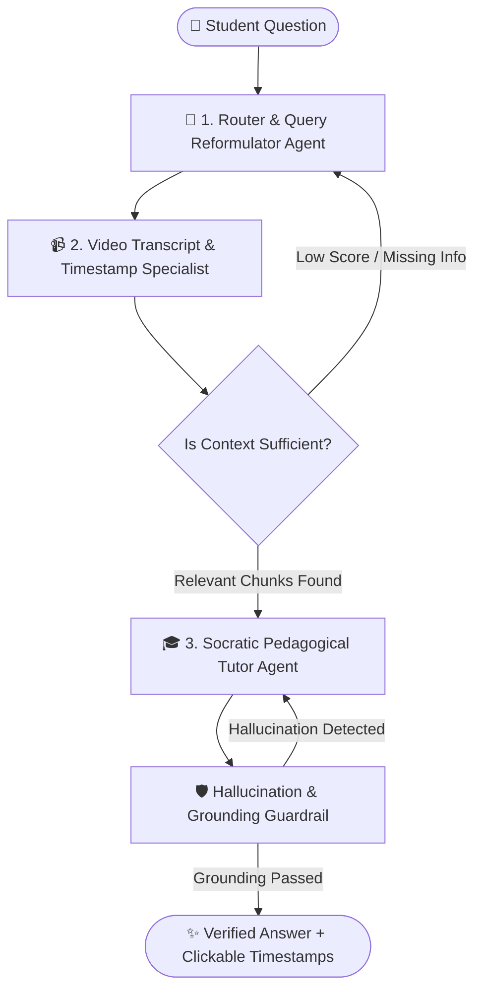

# 🎓 LearnTube AI — Project Overview & Architecture

---

## 📌 1. Project Objective
**LearnTube AI** is an intelligent, multi-agent educational copilot designed to transform long YouTube lectures and video tutorials into interactive, high-impact learning experiences. 

Instead of passively watching hours of video, students can:
* Chat directly with the video content with clickable timestamp video jumps.
* Generate multi-style study summaries and export them as professional PDFs.
* Test their knowledge with adaptive, multi-mode quizzes and explanations.
* Visualize complex concepts through interactive mind maps and architecture flowcharts.

---

## 💡 2. Key Use Cases

| Use Case | Description | User Benefit |
| :--- | :--- | :--- |
| **⚡ Fast Lecture Review** | 2-minute executive digest & key takeaways from 1-hour+ lectures. | Saves 80% study time. |
| **🎯 Interactive Timestamp Q&A** | Ask questions and jump directly to exact lecture timestamps (`▶ MM:SS`). | Zero scrubbing/searching in long videos. |
| **📝 Multi-Mode Exam Practice** | Auto-generated quizzes with instant grading, score cards, and detailed reasoning. | Active recall & exam readiness. |
| **🗺️ Visual Concept Mapping** | AI-generated interactive Concept Mind Maps & Step-by-Step Process Flowcharts. | Structural visual comprehension. |
| **📥 PDF Study Guide Export** | One-click downloadable revision guides with formatted notes and metadata. | Offline revision & note-sharing. |

---

## 🛠️ 3. Tech Stack

| Layer | Technology | Purpose |
| :--- | :--- | :--- |
| **Frontend UI** | **Streamlit** | Modern dark-themed user interface with interactive responsive components. |
| **Backend API** | **FastAPI + Uvicorn** | High-performance asynchronous REST API handling validation, RAG, and agent orchestration. |
| **Orchestration** | **LangChain + LangGraph** | Multi-agent state graph, tool coordination, and prompt pipelines. |
| **LLM Engine** | **OpenAI / Google Gemini** | Context synthesis, answer generation, quiz logic, and diagram architecture. |
| **Vector Database** | **ChromaDB / Qdrant** | Embedding storage and semantic similarity search over timestamped transcript chunks. |
| **Persistent Storage**| **MongoDB** | Video metadata caching, chat history, quiz states, and generated visualizations. |
| **Visualizations** | **Mermaid.js (CDN runtime)** | Interactive vector SVG canvas with pan, scroll-zoom, and fullscreen mode. |
| **PDF Generation** | **ReportLab** | Two-pass PDF compilation engine with running headers and dynamic page counts. |

---

## 🤖 4. Multi-Agent System (LangGraph)

LearnTube AI leverages a **3-Agent Self-Reflective Graph** strictly grounded in the video transcript:

### 👥 Agent Roles
1. **🧠 Router & Query Reformulator Agent:** Analyzes student intent, resolves pronouns from previous chat context, and rewrites vague questions into precise semantic queries.
2. **📹 Video Transcript & Timestamp Specialist:** Searches the vector store, stitches contiguous timestamps, and extracts exact `start_time` / `end_time` intervals.
3. **🎓 Socratic Pedagogical Tutor Agent:** Synthesizes structured educational answers, attaches interactive timestamp buttons, checks for grounding (anti-hallucination), and provides Socratic checkpoint questions.

---

## 🔄 5. End-to-End System Workflow

1. **Video Ingestion & Validation:**
   - User inputs a YouTube URL.
   - **Tier 1 (Regex & Keyword Rule)** + **Tier 2 (LLM Classifier)** verifies if the video is educational.
   - Extracts metadata (Title, Channel, Duration) and raw timestamped transcript.
2. **Semantic Chunking & Indexing:**
   - Transcript is split into overlapping chunks while preserving timestamp boundaries and indexed in ChromaDB/Qdrant.
   - Video metadata and transcript cache are saved to MongoDB for zero-latency instant reloads.
3. **Interactive Learning & Multi-Style Tools:**
   - **Ask AI (Agentic Chat):** Multi-agent loop retrieves, synthesizes, and validates answers.
   - **Summary Studio:** 5 selectable styles (*Study Notes, Quick Summary, Deep Dive, Key Points, Revision Notes*) with instant PDF download.
   - **Quiz Studio:** 4 modes (*Quick Test, Exam Practice, Concept Check, Challenge*) with dynamic question counts and instant answer evaluation.
   - **Visual Studio:** Full-width interactive canvas rendering Concept Mind Maps and Execution Flowcharts with Zoom/Pan and Fullscreen controls.
